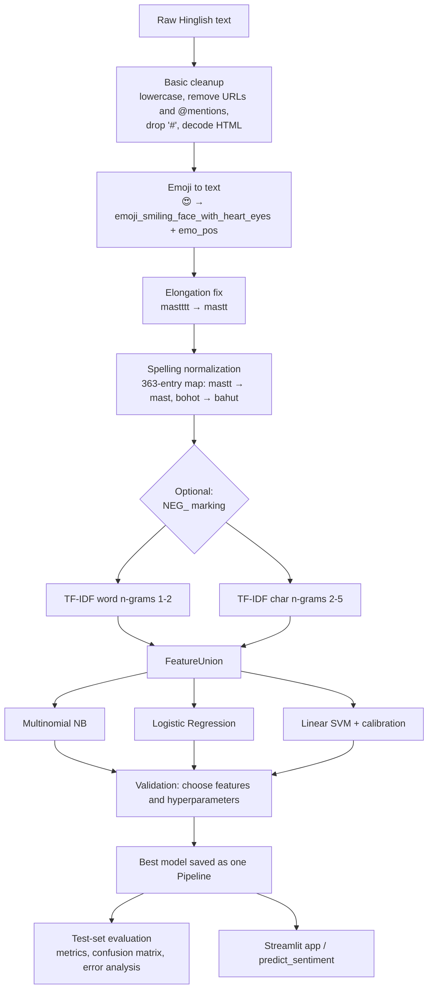

# HinglishSense: report, PPT and viva content

Ready-to-paste text for the project report and presentation. All numbers come from `results/comparison.csv`, `results/ablation.csv` and `results/error_patterns.csv`, produced by the final run. If you retrain, update the numbers.

---

## 1. Abstract

Social media users in India frequently write in Hinglish: Hindi typed in the Roman script and mixed with English. Code-mixing, non-standard spelling, slang and emojis make such text hard for conventional English sentiment analysers. This project presents HinglishSense, a lightweight system that classifies Hinglish text as positive, negative or neutral. We use the SentiMix Hinglish dataset from SemEval-2020 Task 9 (19,675 tweets after cleaning), split 70/15/15 with stratification. A Hinglish-aware preprocessing pipeline handles URLs, mentions, emojis, character elongation and spelling variation through a 363-entry normalization map. Texts are represented with TF-IDF word (1-2) and character (2-5) n-grams, and three classifiers are compared: Multinomial Naive Bayes, Logistic Regression and a calibrated Linear SVM. The Linear SVM performs best, with a test macro-F1 of 0.640 and accuracy of 0.637. An ablation study shows that character n-grams contribute the largest gain. The system is deployed as an interactive Streamlit web application.

## 2. Introduction and motivation

India has hundreds of millions of social media users, and a large share of them do not write in "pure" English or Hindi. They switch between the two languages within a sentence, and usually type Hindi with English letters because that is what phone keyboards make easy. This is called **code-mixing** (or code-switching), and the resulting language is popularly called **Hinglish**.

Businesses, governments and researchers want to know what people feel about products, films, cricket matches and policies, which makes sentiment analysis of this text valuable. Standard tools fail for several reasons:

- **Vocabulary:** English lexicons and models do not know Hindi words such as *mast* (great), *bakwas* (rubbish) or *bekar* (useless).
- **Spelling chaos:** Roman Hindi has no standard spelling. *accha / acha / achha*, *nahi / nhi / nai*, and *bahut / bohot / bhot* are all common.
- **Informal style:** elongations (*mastttt*), shortforms (*plz*, *gr8*), emojis, hashtags and mentions.
- **Grammar differences:** Hindi puts the negator after the word it negates (*accha nahi* = "not good"), unlike English.

This project builds and evaluates a simple, explainable pipeline that addresses these issues.

## 3. Problem statement and objectives

**Problem statement:** Given a short Hinglish text such as a tweet, comment or review, automatically classify its sentiment as *positive*, *negative* or *neutral*.

**Objectives:**
1. Prepare a labelled Hinglish sentiment dataset in a standard `text,label` format.
2. Build a Hinglish-aware preprocessing pipeline: spelling normalization, emoji handling and elongation handling.
3. Train and compare Naive Bayes, Logistic Regression and Linear SVM using TF-IDF word and character n-grams.
4. Optionally fine-tune a multilingual transformer (XLM-RoBERTa) when a GPU is available.
5. Evaluate with accuracy, macro-F1, per-class precision/recall, confusion matrices and error analysis.
6. Deploy a Streamlit web demo for real-time prediction.

## 4. Literature survey

> Each reference must be checked against the original paper before submission. Details are given from memory and marked **[VERIFY REFERENCE]**.

1. **Patwa et al. (2020), "SemEval-2020 Task 9: Overview of Sentiment Analysis of Code-Mixed Tweets"**, Proceedings of SemEval-2020. Introduced the SentiMix shared task with Hinglish and Spanglish tweets annotated with word-level language tags and sentence-level sentiment (positive / negative / neutral). Many teams took part, and the best Hinglish systems used transformer ensembles with an F1 around 0.75. **[VERIFY REFERENCE]**
2. **Joshi, Prabhu, Shrivastava and Varma (2016), "Towards Sub-Word Level Compositions for Sentiment Analysis of Hindi-English Code Mixed Text"**, COLING 2016. Proposed a sub-word (character-based) LSTM for Hinglish sentiment and argued that sub-word units cope better with non-standard spelling. This supports our use of character n-grams. **[VERIFY REFERENCE]**
3. **Conneau et al. (2020), "Unsupervised Cross-lingual Representation Learning at Scale" (XLM-RoBERTa)**, ACL 2020. A multilingual transformer pre-trained on text in about 100 languages, widely used as a strong baseline for code-mixed tasks. It is the model in our optional fine-tuning notebook. **[VERIFY REFERENCE]**
4. **Khanuja et al. (2020), "GLUECoS: An Evaluation Benchmark for Code-Switched NLP"**, ACL 2020. A benchmark of code-switched tasks, including Hinglish sentiment, that compares multilingual BERT-style models and shows the benefit of further training on code-switched data. **[VERIFY REFERENCE]**
5. **Sharma, Srinivas and Balabantaray (2015/2016), work on text normalization and sentiment analysis of Hinglish social media text.** Showed that normalizing spelling variants and transliteration before classification improves results, which motivates our normalization map. **[VERIFY REFERENCE: confirm exact title, venue and year]**

## 5. Dataset description

| Item | Value |
|---|---|
| Source | SentiMix Hinglish, SemEval-2020 Task 9 (Hugging Face mirror `RTT1/SentiMix`, tagged `openrail`) |
| Original format | CoNLL: a `meta <id> <sentiment>` line followed by one `token<TAB>language-tag` per line |
| Original parts | train 14,000, dev 3,000, test 3,000 (test labels in a separate file) |
| After cleaning | **19,675 tweets** (325 empty or duplicate rows removed) |
| Labels | neutral 7,354 (37.4%), positive 6,506 (33.1%), negative 5,815 (29.6%) |
| Split | stratified 70 / 15 / 15: train 13,772, validation 2,951, test 2,952 (`random_state=42`) |

**Conversion steps:** tokens were joined back into sentences. @mentions and split-up URLs were removed, `#` was re-attached to hashtag words, and wrongly decoded emojis (e.g. `😂` → 😂) were repaired. The three official parts were pooled and re-split as required by the project brief, so our scores are not directly comparable to the SemEval leaderboard.

**Class balance:** mildly imbalanced (largest/smallest ≈ 1.26). We report macro-F1 and use `class_weight="balanced"` for LR and SVM.

## 6. Methodology

### 6.1 System flowchart

### 6.2 Preprocessing

1. **Basic cleanup:** lowercase; remove URLs and @mentions (no sentiment, only noise); keep hashtag words; decode HTML entities.
2. **Emojis:** each emoji becomes a word token named after it, and common emojis also add `emo_pos` or `emo_neg`, so that rare emojis with the same feeling share a strong feature.
3. **Elongation:** characters repeated three or more times are cut to two (*bahuttttt* → *bahutt*), and the normalization map then fixes the result (*bahutt* → *bahut*).
4. **Spelling normalization:** 363 variant → canonical pairs, built from the most frequent spellings in the training data plus chat slang (*plz* → *please*, *gr8* → *great*). Ambiguous forms that are also English words (*he*, *me*, *main*) were left out on purpose.
5. **Negation marking (experiment):** prefix `NEG_` to the two words after a negator, or on both sides of it. Evaluated in the ablation study and switched off because it did not improve validation scores.

**Why no stopword removal?** English stopword lists delete "not", "no" and "but", and Hindi function words such as *hi*, *bhi*, *to* and *na* change the meaning of a sentence ("accha **hi** tha" vs "accha **nahi** tha").
**Why no stemming or lemmatization?** Available stemmers (e.g. Porter) only understand English and would damage Romanized Hindi words. Character n-grams already capture shared word parts.

### 6.3 Features: TF-IDF word and character n-grams

- **TF-IDF** weighs a term by how often it appears in a document (TF) and how rare it is across all documents (IDF). We use sublinear TF (1 + log tf), so repeated words do not dominate.
- **Word n-grams (1-2):** capture words and short phrases such as "bahut accha" and "paisa waste".
- **Character n-grams (2-5, inside word boundaries):** "accha", "acha" and "achha" share most of their character n-grams, so the model can match spelling variants the map misses. This is the single most useful idea in the project (see the ablation study).
- Both are combined with a `FeatureUnion` (about 108k features), with `min_df=2` to drop terms seen only once.

### 6.4 Models

- **Multinomial Naive Bayes:** a probabilistic model using Bayes' theorem with the "naive" assumption that features are independent. Fast, and a strong baseline for text.
- **Logistic Regression:** a linear model that learns one weight per feature per class and outputs probabilities through softmax. Interpretable: we can read off the most positive and negative features.
- **Linear SVM:** finds the maximum-margin hyperplane between classes, and works very well with high-dimensional sparse text features. It is wrapped in `CalibratedClassifierCV` to obtain probabilities for the confidence score.
- **(Optional) XLM-RoBERTa:** a multilingual transformer fine-tuned end to end. Not run locally (no GPU); a Colab notebook is provided.

## 7. Implementation details

| Item | Value |
|---|---|
| Language and libraries | Python 3.12, pandas, NumPy, scikit-learn, emoji, regex, Matplotlib/Seaborn, Streamlit, pytest |
| Word TF-IDF | `ngram_range=(1,2)`, `min_df=2`, `sublinear_tf=True` |
| Char TF-IDF | `analyzer="char_wb"`, `ngram_range=(2,5)`, `min_df=2`, `sublinear_tf=True` |
| Naive Bayes | alpha ∈ {0.1, 0.5, 1.0} → **1.0** |
| Logistic Regression | C ∈ {0.1, 1, 10} → **1.0**, `max_iter=1000`, `class_weight="balanced"` |
| Linear SVM | C ∈ {0.1, 1, 10} → **0.1**, `class_weight="balanced"`, calibrated with 3-fold CV |
| Model selection | best **validation** macro-F1; test set used only for final reporting |
| Transformer (optional) | xlm-roberta-base, 3 epochs, lr 2e-5, batch 16, max length 64, fp16 |
| Hardware | ordinary CPU laptop; each model trains in under 10 s |
| Reproducibility | `random_state=42` everywhere; the whole pipeline is rerun with 3 commands |

## 8. Results and discussion

### 8.1 Test-set results

| Model | Accuracy | Macro-F1 | Weighted-F1 |
|---|---|---|---|
| Multinomial Naive Bayes | 0.619 | 0.622 | 0.617 |
| Logistic Regression | 0.626 | 0.629 | 0.624 |
| **Linear SVM (calibrated)** | **0.637** | **0.640** | **0.636** |

Per-class F1 on test:

| Class | NB | LR | SVM |
|---|---|---|---|
| negative | 0.647 | 0.665 | 0.667 |
| neutral | 0.534 | 0.538 | 0.565 |
| positive | 0.685 | 0.685 | 0.689 |

*Figures: `results/model_comparison.png`, `results/confusion_linear_svm.png` (and one per model).*

**Discussion:** all three linear models are within 2 macro-F1 points of each other, which suggests the features matter more than the classifier. The SVM is best on test. On validation, SVM and LR were practically tied (0.6396 vs 0.6388), so either is a defensible choice. A macro-F1 of 0.64 is in the range normally reported for classical models on SentiMix-style data; transformer ensembles reach about 0.75 on the official split [VERIFY REFERENCE].

### 8.2 Ablation study (Logistic Regression, C = 1)

| Variant | Val macro-F1 | Test macro-F1 |
|---|---|---|
| word only | 0.624 | 0.615 |
| word only, no normalization | 0.623 | 0.612 |
| char only | 0.638 | 0.636 |
| word + char | 0.639 | 0.629 |
| word + char, no normalization | 0.637 | 0.628 |
| word + char + NEG_ (after) | 0.636 | 0.631 |
| word + char + NEG_ (both sides) | 0.635 | 0.632 |

*Figure: `results/ablation.png`.*

- **Character n-grams give the biggest gain** (about +1.4 validation points, +1.5 to +2 test points over words only), confirming that sub-word features handle spelling variation.
- **The normalization map helps slightly** (+0.1 to +0.3). Character n-grams already recover most variants, so the map adds less once they are present.
- **NEG_ marking did not help on validation.** Negation in Hinglish is often post-posed (*accha nahi*), many negators also have other uses (*na* is also a question tag), and character n-grams already see "nahi". It was therefore left off.
- Differences below about 1 point are within the noise of a 2,952-tweet test set.

### 8.3 Interpretability

*Figure: `results/top_features_lr.png`.* The strongest positive features include *good, love, great, proud, best, congratulations, badhai, ji, dil, bahut*. The strongest negative features are mainly abuse and insults (*bc, shame, chor, saale, fake, teri, tu*) plus *nahi*. This shows the model has learned real Hinglish sentiment cues, but also that SentiMix negativity is dominated by abusive political tweets.

### 8.4 Error analysis (Linear SVM, 1,073 misclassified test tweets)

| Pattern (automatic heuristic) | Share of test set | Share of errors | Error rate when present |
|---|---|---|---|
| contains a negator | 34.2% | 39.6% | **42.1%** (overall error rate 36.4%) |
| contrast word (but/lekin/par/magar) | 7.3% | 7.6% | 38.1% |
| sarcasm hint (wah, wow, great, lol...) | 3.8% | 3.5% | 34.2% |
| very short text (≤ 4 words) | 0.8% | 0.7% | 28.0% |
| ≥ 30% words unseen in training | 5.9% | 6.6% | 40.6% |

Confusions: neutral ↔ positive **45.2%** of errors, neutral ↔ negative **43.4%**, positive ↔ negative only **11.4%**.

**Top failure patterns:**
1. **Neutral vs. the rest (≈ 89% of errors).** The model rarely flips positive to negative, but it struggles to decide whether a tweet is opinionated at all. Congratulatory political tweets (*"jeet ki hardik badhai avm subhkamnaye"*) are labelled neutral in the data but predicted positive.
2. **Negation:** tweets with a negator have a clearly higher error rate (42% vs 36% overall). *"khana accha nahi tha"* is predicted neutral, because a bag of n-grams sees *accha* (positive) and *nahi* (negative) and the two cancel out.
3. **Mixed sentiment:** *"movie ekdum mast thi, but climax thoda boring tha"* contains both feelings and is predicted neutral. The heuristic is noisy, though: *par* also means "on".
4. **Sarcasm:** *"you are absolutely right. the great rahul gandhi is hope of people…"* (true: neutral/sarcastic) is predicted positive. Word-level models cannot detect irony.
5. **Unknown words and other scripts:** tweets with many unseen words (rare spellings, Devanagari, other languages) have a 41% error rate.
6. **Very short texts** are rare in SentiMix (0.8%) and not a major error source here, but short demo inputs give low-confidence predictions.
7. **Label noise:** several of the most confident errors look mislabelled (abusive tweets labelled *positive*, and congratulations labelled *neutral*), which caps the achievable score.

## 9. Comparison of all models

| Model | Test acc. | Test macro-F1 | Train time | Inference / sample | Model size | Probabilities |
|---|---|---|---|---|---|---|
| Multinomial NB | 0.619 | 0.622 | 4.3 s | 0.27 ms | 7.3 MB | native |
| Logistic Regression | 0.626 | 0.629 | 8.7 s | 0.27 ms | 4.7 MB | native |
| Linear SVM | **0.637** | **0.640** | 5.9 s | 0.27 ms | 9.9 MB | via calibration |
| XLM-RoBERTa | not run (no GPU) | – | ~15-25 min on a Colab T4 (estimate) | – | ~1.1 GB | native |

Train times include preprocessing and vectorization. Inference time is mostly preprocessing, which is why it is the same for all three models.

## 10. Conclusion

We built HinglishSense, a complete and reproducible sentiment analysis system for Hindi-English code-mixed text. A Hinglish-aware preprocessing pipeline with emoji conversion, elongation handling and a 363-entry spelling map, combined with TF-IDF word and character n-grams, gives a test macro-F1 of 0.640 with a calibrated Linear SVM on 19.7k SentiMix tweets. Every model trains in seconds on a CPU. The ablation study shows that character n-grams are the most valuable component for noisy Romanized Hindi. Error analysis shows that the main challenges are the neutral class, negation, mixed sentiment, sarcasm and label noise. The system is deployed as an easy-to-use Streamlit app, and a Colab notebook is ready for transformer fine-tuning.

## 11. Limitations and future scope

**Limitations**
- **Sarcasm and irony** cannot be captured by n-gram features.
- **Negation and word order:** "accha nahi" is only partly understood, and NEG_ marking did not help.
- **Noisy and limited data:** about 20k tweets, some mislabelled, many truncated with "…", and about 1% with broken emoji bytes.
- **Roman-script spelling chaos:** the 363-entry map covers only common variants.
- **Domain shift:** the data is political, cricket and celebrity tweets, so product, food and movie reviews are out of domain.
- **Devanagari input** is not transliterated and is too rare in training to be learned.

**Future scope**
- Fine-tune XLM-RoBERTa, MuRIL or IndicBERT (notebook provided).
- Transliteration between Roman Hindi and Devanagari as a preprocessing step.
- Hinglish-specific embeddings (e.g. fastText trained on code-mixed corpora).
- Aspect-based sentiment analysis ("camera accha hai but battery bekar").
- Better handling of emojis, memes and multimodal posts.
- Deployment as a REST API (FastAPI) or a browser extension that labels comments live.

## 12. Viva questions with short answers

1. **What is code-mixing?** Using two or more languages within the same sentence or conversation, for example Hindi and English in "movie mast thi but boring ending".
2. **What is Hinglish?** Hindi written in the Roman alphabet and mixed with English words, very common on Indian social media.
3. **Why do English sentiment tools fail on Hinglish?** They don't know Hindi words, Hindi has no fixed Roman spelling, and the text is full of slang, elongations and emojis.
4. **What is TF-IDF?** Term Frequency × Inverse Document Frequency. A word gets a high weight if it is frequent in this text but rare across all texts, so common words get low weight.
5. **Why character n-grams?** Spelling variants (acha/accha/achha) share most character n-grams, so the model generalizes across spellings and typos. In our ablation they gave the biggest gain.
6. **What does `char_wb` mean?** Character n-grams taken only inside word boundaries (words padded with spaces), so n-grams don't span two words.
7. **Why didn't you remove stopwords?** Words like "not", "no", "nahi", "hi" and "bhi" carry sentiment or change meaning, and no reliable Hinglish stopword list exists.
8. **Why no stemming or lemmatization?** Existing stemmers are English-only and would damage Romanized Hindi words. Character n-grams already capture shared word parts.
9. **What is the normalization map?** A CSV of 363 variant → canonical spellings (bohot → bahut, nhi → nahi, plz → please) applied after cleaning.
10. **What is macro-F1 and why use it over accuracy?** The F1 score is computed for each class and then averaged with equal weight. Unlike accuracy, it is not dominated by the largest class, so a model can't score well by ignoring a minority class.
11. **What is class imbalance and how did you handle it?** Unequal class sizes (here 37/33/30%). We used a stratified split, `class_weight="balanced"`, and macro-F1.
12. **Why a separate validation set?** To choose hyperparameters and features without looking at the test set. If we tuned on the test set, the reported score would be optimistically biased.
13. **What is a stratified split?** A split that keeps the same label proportions in train, validation and test.
14. **How does Naive Bayes work?** It applies Bayes' theorem, assuming the features are independent given the class, and picks the class with the highest posterior probability.
15. **Why does Linear SVM work well for text?** Text features are high-dimensional and sparse, and classes are often nearly linearly separable there. SVM maximizes the margin, which generalizes well.
16. **Why wrap the SVM in `CalibratedClassifierCV`?** SVM outputs distances, not probabilities. Calibration maps them to probabilities so we can show confidence in the app.
17. **What is a transformer?** A neural network built on self-attention, which lets every word look at every other word. Pre-trained transformers like BERT and XLM-R learn language from huge text corpora.
18. **What does fine-tuning mean, and why do it?** Continuing to train a pre-trained model on our labelled data, so its general language knowledge is adapted to Hinglish sentiment with relatively little data.
19. **What is an ablation study, and what did yours show?** Removing or changing one component at a time to measure its contribution. Character n-grams helped most, normalization helped slightly, and NEG_ marking didn't help.
20. **What are the main limitations?** Sarcasm, negation, the neutral class, noisy labels, domain shift (tweets vs reviews), and no Devanagari transliteration.
21. *(Bonus)* **What is a confusion matrix?** A table of true vs predicted labels. It shows which classes get confused; for us, neutral is confused with both of the others.
22. *(Bonus)* **How is your pipeline deployed?** The cleaner, vectorizers and model are saved as one scikit-learn Pipeline (joblib), loaded once by the Streamlit app with `st.cache_resource`.

## 13. 10-slide PPT outline

1. **Title:** HinglishSense: Sentiment Analysis of Hindi-English Code-Mixed Text. Team names, guide, department, Mumbai University, year.
2. **Introduction and motivation**
   - Hinglish = Romanized Hindi + English, everywhere on Indian social media
   - Example: "movie ekdum mast thi, but climax thoda boring tha"
   - English tools fail: unknown words, spelling chaos, slang, emojis
3. **Problem statement and objectives**
   - Classify text as positive / negative / neutral
   - Hinglish-aware preprocessing; compare NB, LR, SVM; web demo
4. **Literature survey**
   - SemEval-2020 SentiMix; sub-word models for Hinglish; XLM-R; GLUECoS
   - Gap: simple, explainable, CPU-only pipeline with Hinglish normalization
5. **Dataset**
   - SentiMix Hinglish: 19,675 tweets; 37% neutral, 33% positive, 30% negative
   - Stratified 70/15/15 split; cleaning steps (mentions, URLs, emoji repair)
6. **Methodology** (show the Mermaid flowchart)
   - Cleanup → emoji tokens → elongation fix → 363-entry normalization map
   - TF-IDF word 1-2 + char 2-5 n-grams → NB / LR / SVM
7. **Implementation**
   - Python, scikit-learn, Streamlit, pytest
   - Hyperparameters tuned on validation; whole pipeline saved as one model file
8. **Results**
   - Table: SVM 0.640, LR 0.629, NB 0.622 test macro-F1
   - Confusion matrix and ablation chart (char n-grams give the largest gain)
9. **Error analysis and demo**
   - Neutral confusion (≈ 89% of errors), negation, sarcasm, label noise
   - Screenshot or live demo of the Streamlit app
10. **Conclusion and future scope**
    - Explainable CPU-only baseline at macro-F1 0.64
    - Next: XLM-R/MuRIL fine-tuning, transliteration, aspect-based sentiment, API/browser extension
